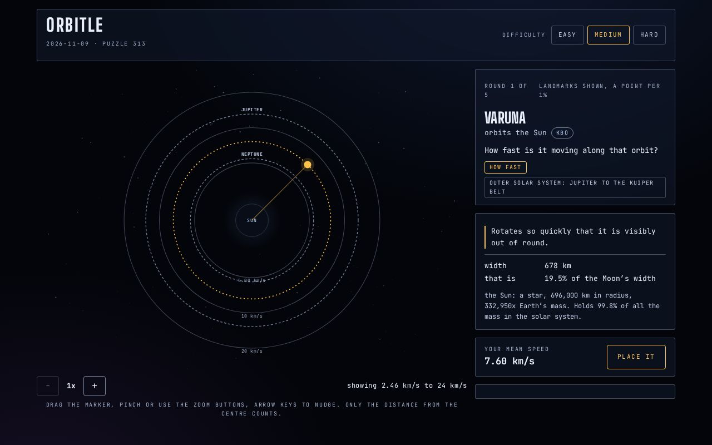

<div align="center">



# Orbitle

**A daily guessing game about orbits. How far out, how long one lap takes, how fast it is going.**

[Play it](https://orbitle.futile.studio) · [How it works](HOW-IT-WORKS.md) · [Futile Studio](https://futile.studio)

[](https://orbitle.futile.studio)


[](https://github.com/MayurJivani/Orbitle/commits/main)

</div>

> **Futile Lab** · daily game · Live since Oct 2026

## Overview

Five rounds a day. Each round names a thing (a station, a moon, a comet, a dead
mission) and asks one of three questions about its orbit. You answer by dragging
a marker onto a log-scale dial. Everyone gets the same five rounds on the same
day, picked by a seeded shuffle of the UTC date.

Drag the marker to the ring you think is right, or use the arrow keys. The angle
is decoration: only the distance from the centre counts. Zoom with the wheel, or
`+` and `-`, to spread the rings out when you want to be precise. Zooming never
changes the marking.

## How to play

### The three questions

| Question | Asked as | Dial |
| :--- | :--- | :--- |
| How far out | distance from whatever it orbits | km, millions of km, AU |
| How long | one orbit, start to finish | hours, days, years |
| How fast | mean speed along the orbit | km/s |

Only the distance is curated. The period and the speed are Kepler's third law
and a square root over the same number, so they cannot disagree with it.

### The five frames

A round is asked on whichever frame its answer lives in. The first two are read
against Earth whatever the round is about, because knowing Io orbits Jupiter a
little further out than our own Moon is the kind of answer worth having.

| Frame | Span |
| :--- | :--- |
| Near Earth | surface to just past geostationary |
| Earth system | geostationary to past the Moon |
| Inner solar system | Mercury to the asteroid belt |
| Outer solar system | Jupiter to the Kuiper belt |
| Deep space | past Eris, out to Sedna |

### Three difficulties

| Mode | What changes |
| :--- | :--- |
| Easy | landmark rings shown, gentle marking |
| Medium | landmark rings shown, a point per 1% of the dial missed |
| Hard | no landmarks, no frame named, and the dial covers the whole sky |

Score is 100 a round on the share of the dial you missed by, so five rounds
across different dials still add up to one comparable total. Easy and Hard bend
that line with an exponent rather than a gentler slope, so exact is 100 and a
full miss is 0 in every mode. The mode is a choice for the day and locks when
you place your first answer, since it is what the earlier rounds were scored on.

### What you know before you answer, and after

Before placing anything you get a briefing: what the thing is, how wide it is
and what that is a fraction of, and a line about its host (what kind of body,
how wide, how heavy, and one fact about it). Enough to reason with.

What the briefing can never contain is any of the three quantities, because
distance, period and speed are all derivable from each other given the host, so
stating one gives away all three. That also rules out the per-entry notes, since
many of them say it outright ("about 420 km up", "30 AU"), which is why those
are held back. A test walks every entry against every question to prove the
briefing says none of them.

The reveal then adds what the answer unlocked: how far above the host's surface
it actually sits, in host radii, how long light takes to cross that distance,
how many orbits a year it works out to, and the note.

None of it is written out per entry. Each entry carries one distance and one
width; the host contributes a radius, a mass and a note; everything else is
arithmetic over those. Ninety-nine entries would otherwise need ninety-nine
paragraphs, and most of them would go stale.

Ninety-nine things to be asked about, in eighteen categories: stations, spy
satellites, dead missions, moons, Trojans, centaurs, Kuiper belt objects,
comets and the rest. Growing that list (in `shared/objects.js`) is the cheapest
way to improve the game, and it is the only part of this repo that needs no
code.

### On a phone

The question sits above the dial, the readout and the one button that matters
are a fixed bar at the bottom, pinching the dial zooms it, and the marker's
touch target is 57 px across. The dial's labels are set in SVG user units, so
they are scaled up on a narrow screen to land at a readable size rather than
the five pixels they would otherwise render at.

## Stack

- Astro 7, static output, no server at all
- Plain JS for the dial and game logic (`src/scripts/client.js`, `shared/orbit.js`)
- Self-hosted fonts via Fontsource (Big Shoulders Display, JetBrains Mono)
- Guesses saved in `localStorage`, nothing leaves the browser
- Tests on the built-in `node --test` runner

The reasoning (why log dials, why five frames, why no backend) is in
**[HOW-IT-WORKS.md](HOW-IT-WORKS.md)**.

## Running it locally

Needs Node 22.12 or newer.

```sh
npm install
npm run dev       # astro dev --host
npm test          # node --test "tests/*.test.js"
npm run build     # static site in dist/
npm run preview
```

There are no environment variables.

## Project structure

```
shared/objects.js     the catalogue: 99 entries and their hosts
shared/orbit.js       Kepler, dials, frames, scoring, the daily seed
src/pages/index.astro the page
src/scripts/client.js the dial, zoom, briefing and reveal in the browser
tests/                orbit maths, briefing leaks, no third-party loads
deploy/               deploy script and the Caddy site block
```

## Deploying

It is a static build, so the server just serves `dist/` off the disk and there
is nothing to restart. `deploy/deploy.sh` runs the tests, builds locally, copies
the Caddy site block over (validating it and rolling back if Caddy rejects it),
then streams `dist/` to the app directory over SSH. Run it from a dev box, not
the server. The target host comes from `HOST`.

```sh
deploy/deploy.sh
```

The tunnel in front of the server is token-managed, so the hostname's ingress
points at `http://localhost:80` in the Cloudflare dashboard, which is the one
part of the route that cannot be set from the box.

## Roadmap

Planned in [plan.md](plan.md): a 3D mode next to the dial, in the spirit of
Universe Sandbox 2, Celestia and Gravity Simulator. You would place a body and
let it orbit, and the reveal would run your orbit and the real one together.
The dial stays as the default, since a daily game should not need a GPU.

## Licence

No licence file yet, all rights reserved.

---

<p align="center"><sub>Built by <a href="https://github.com/MayurJivani">Mayur Jivani</a> at <a href="https://futile.studio">Futile Studio</a>. Everything is futile. Do it anyway.</sub></p>
